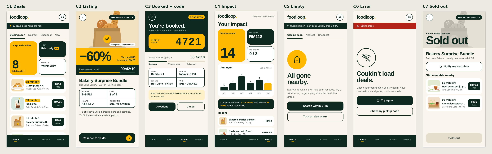

# foodloop
FoodLoop is a proposed software-based marketplace designed to connect food businesses with customers interested in unsold surplus food at discounted prices. 

Students and nearby customers reserve discounted surplus food from campus sellers (cafés, bakeries,
food stalls) and collect it themselves during a pickup window. Leftovers can be offered to a food bank.
Built for the ENT600 Technology Entrepreneurship New Product Development (NPD) assignment.



## Status

| Part | Status |
|---|---|
| System workflow and business rules | ✅ designed |
| UI mockups (style C: forest, marigold, cream) | ✅ approved |
| Laravel + MySQL prototype | ✅ Prototype complete (Stages 0–8): students reserve and see their impact, shops post food and hand it over by code, admins approve shops and handle reports · demo script in `docs/DEMO_SCRIPT.md` |

All shop names, prices and numbers in the mockups and in the app are **demo data**, not real offers or
research results. Payments are simulated.

## Run it locally

For Windows with [Laragon](https://laragon.org) (it brings PHP, MySQL, Composer and Node). First time:
about 10 minutes, mostly downloads.

**0. Check your tools (1 min).** Start Laragon, click **Start All**, then click **Terminal** and run:

```
php -v
composer -V
node -v
mysql --version
```

You need PHP 8.3 or newer, Composer 2.x, Node 20.19 or newer (22 is fine) and MySQL 8.x. If PHP is older
than 8.3, switch it in Laragon: Menu → PHP → Version. If a command is "not recognized", you are probably in
plain PowerShell: use Laragon's **Terminal** button instead.

Every command in this README works in Laragon's Terminal (which is a Command Prompt) and in PowerShell.

**1. Get the code (1 min).**

```
cd C:\laragon\www
git clone https://github.com/hamoodalsahur/foodloop.git
cd foodloop
```

Already cloned? Run `git pull` inside the folder instead.

**2. Install and set up (5–8 min).**

```
composer install
copy .env.example .env
php artisan key:generate
mysql -u root -e "CREATE DATABASE IF NOT EXISTS foodloop; CREATE DATABASE IF NOT EXISTS foodloop_test;"
php artisan migrate:fresh --seed
php artisan storage:link
npm install
npm run build
```

Success looks like: `composer install` ends without red errors, `migrate:fresh --seed` ends with
`DemoSeeder ... DONE`, and `npm run build` ends with `✓ built`. If your MySQL root user has a password, add `-p` to the `mysql`
command and put the password in `DB_PASSWORD` in `.env`.

`ERROR 2003 ... Can't connect to MySQL server on 'localhost:3306' (10061)` means MySQL isn't running: click
**Start All** in Laragon's window and wait until MySQL shows as started, then run the command again.

**3. Start it.**

```
php artisan serve
```

Open <http://localhost:8000>. You should see the cream FoodLoop page with a marigold "Good food shouldn't
go to waste." card. Stop the server with `Ctrl + C`.

While changing the design, also run `npm run dev` in a second terminal so style changes show immediately.

**Keep the clock running.** Two jobs run every minute: one turns reservations that weren't collected into
no-shows, the other closes listings whose pickup window is over and offers leftovers to the food bank.
They only run while this command is open in its own terminal (leave it running during a demo):

```
php artisan schedule:work
```

Success looks like a new pair of lines every minute naming `reservations:expire` and `listings:close`.

**Using Herd instead?** The same commands work, but free Herd has no MySQL, so you need Herd Pro's MySQL
service or another MySQL 8 server. Put its user and password in `.env`.

## Demo data and demo accounts

`php artisan migrate:fresh --seed` wipes the database and fills it with the **demo data** from the mockups
(about 5 seconds). Run it again any time to reset, for example right before a demo: pickup times are set
from the moment you run it, so there are always deals closing soon.

Every account signs in with the password **`password`**. The people are made up. The approved shops are
**real food places on and around the UiTM Kedah campus in Merbok** (within 5 km of the main gate), but they
have not joined FoodLoop: their listings, prices, halal statuses and sales are demo data, and their SSM and
phone numbers are deliberately fake (`DEMO-0001`, "Demo number"). The three shops waiting for approval are
made up. Never use this data or this password on a real server.

| Role | Email | Who |
|---|---|---|
| Admin | `admin@foodloop.test` | FoodLoop Admin |
| Seller | `bondamawar@foodloop.test` | Bonda Mawar Cake House, Sungai Layar, 4.5 km (shown as halal certified) |
| Seller | `merbokroasted@foodloop.test` | Merbok Roasted, in front of the main gate, 0.1 km |
| Seller | `sebunga@foodloop.test` | Se.Bunga Kafe UiTM, on campus, 0.3 km (Aina's pickup 2468 for the demo) |
| Seller | `kopisaigon@foodloop.test` | Kopi Saigon Merbok, Taman Lembah Bujang, 1.5 km |
| Seller | `kuihtupah@foodloop.test` | Kuih Tradisional Tupah, Kampung Tupah Lama, 2.7 km |
| Seller, waiting for approval | `kedaikopisinar@foodloop.test` · `dapurbonda@foodloop.test` · `sweetcrumbs@foodloop.test` | Kedai Kopi Sinar · Dapur Bonda · Sweet Crumbs Bakehouse |
| Customer | `aina@foodloop.test` | Aina Rahman: has a reservation tonight (code 4721) and 14 past pickups |
| Customer | `hafiz@foodloop.test` · `priya@foodloop.test` · `meiling@foodloop.test` | Hafiz, Priya, Mei Ling: reservations today |
| Customer, blocked | `daniel@foodloop.test` · `farah@foodloop.test` | Blocked after 3 no-shows, for 5 and 2 more days |
| Customer, 2 strikes | `jason@foodloop.test` | One more no-show and he is blocked |

Log in at <http://localhost:8000/login>. Customers land on the deals, sellers on `/seller`, the admin on
`/admin`.

## Try the student flow

With `php artisan serve` running and the demo data seeded (about 2 minutes):

1. Open <http://localhost:8000>. You see tonight's deals, closing soonest first. Try the tabs
   (Nearest, Cheapest), the **Halal only** and **Distance** tiles and the food chips.
2. Tap **Bakery Surprise Bundle**. You see the −60% band, the live countdown and the facts box.
3. Tap **Log in to reserve**, then **Create an account** and sign up with any name and email
   (or log in as `aina@foodloop.test` / `password`). You come straight back to the bundle.
4. Pick how many, choose **Pay now** or **Pay at pickup**, tap **Reserve for RM…**.
5. You land on **You're booked.** with your 4-digit pickup code, the countdown to the pickup window and
   the free-cancellation time. **Orders** in the menu lists all your reservations.
6. Tap **Cancel**, then **Yes, cancel**: it's free at this point and the food goes back on sale.

To see the other states: reserve everything that's left of a deal and open it again (**Sold out**), open
<http://localhost:8000/?category=groceries> (**All gone nearby**), or log in as `daniel@foodloop.test`
(blocked: **You can't reserve until…**). As Aina, **Impact** in the menu shows her rescued meals and money saved; **Map** shows the shops with deals on a street map around campus; tap a pin for **See deals** or
**Directions** (opens Google Maps). With no internet the map falls back to a simplified drawing.

## Try the seller flow

With `php artisan serve` running and the demo data freshly seeded (about 3 minutes):

1. Log in as `bondamawar@foodloop.test` / `password`. You land on **Tonight**: the four number tiles, the
   pickups table, live listings and the "Left over at closing?" card.
2. Tap **New listing**, fill in a name and prices (FoodLoop price lower than the normal price), keep the
   suggested pickup time and tap **Publish listing**. Open <http://localhost:8000> in a private window:
   your listing is on the deals page.
3. Back on the dashboard, Aina's code is **4721**. Her pickup window opens about 45 minutes after seeding;
   before that the code check says the window hasn't opened yet, after it **Check and collect** hands it
   over (or tap **Mark collected** on her row, which appears once the window opens).
4. Open the Bakery Surprise Bundle under **Listings**: it has reservations, so the price, portions, pickup
   time and halal status are greyed out. You can still change the name, photo and description, or pause it.
5. On the dashboard, tap **Offer to food bank** next to a closed listing. **Donations** lists it.

To sign up a new shop, log out and open <http://localhost:8000/sell>. The shop waits for approval: it can
save drafts but **Publish** stays hidden until an admin approves it.

## Try the admin side

Log in as `admin@foodloop.test` / `password` (about 2 minutes):

1. **Overview** shows shops to approve, open reports, no-show limits and platform totals.
2. **Sellers**: approve one of the shops waiting for approval (or reject it). For a shop that says it is
   halal certified, open its certificate first.
3. **Reports**: hide a reported listing, warn the seller, or dismiss the report. The seller sees the
   warning on their dashboard.
4. **Customers**: lift a no-show limit or clear strikes.

Customers can report a listing from its page ("Something wrong? Report this listing").

## Demo for the pitch

`docs/DEMO_SCRIPT.md` is a 2-minute click-through (student reserves, seller hands over, impact, admin),
with setup steps and what to do if something goes wrong. Reseed no more than 30 minutes before you
present: the deals count down for real.

## Open it on your phone (and install it like an app)

FoodLoop can be added to a phone's home screen: it gets its own icon and opens full screen. Phones only
allow that over **https**, so you give your laptop a temporary https link with Cloudflare's free tunnel.

**Once** (about 2 minutes), in Laragon's terminal:

```
winget install --id Cloudflare.cloudflared
```

Success looks like `Successfully installed`. Close the terminal and open a new one so it finds the command.

**Each time** (about 1 minute): keep `php artisan serve` running in one terminal, and in a second one run:

```
cloudflared tunnel --url http://localhost:8000
```

After a few seconds it prints a box with a link like `https://some-random-words.trycloudflare.com`. Open
that link on any phone (Wi-Fi or mobile data, it doesn't matter). Then:

- **Android (Chrome):** menu **⋮ → Add to Home screen → Install**.
- **iPhone (Safari):** **Share → Add to Home Screen**.

Good to know:

- The link changes every time you start the tunnel, and stops working when you press **Ctrl + C**.
  While it runs, anyone with the link can open the app: it only holds demo data, but don't leave it on.
- Use `npm run build`, not `npm run dev`, while tunnelling (the dev server only works on the laptop).
  If the phone shows a page without styling, stop `npm run dev`, run `npm run build` and reload.
- Without internet the installed app shows a friendly "You're offline" page.

## See the design system

While `php artisan serve` is running, these pages show the building blocks every screen is made of, with
sample data. They only exist on your own machine (`APP_ENV=local`):

| Address | What it shows |
|---|---|
| <http://localhost:8000/dev/components> | Every component: buttons, cards, price box, deal rows, status pills, empty and error states… |
| <http://localhost:8000/dev/layouts/customer> | The phone-first customer layout with the bottom navigation |
| <http://localhost:8000/dev/layouts/dashboard> | The seller/admin layout with the forest sidebar |

Success looks like the pages in `docs/screenshots/stage3-*.png`. If the food pictures are grey plates, run
`php artisan migrate:fresh --seed` and `php artisan storage:link` first. The rules for building screens are
in `docs/UI_GUIDE.md`.

## Run the tests

Quick run on SQLite in memory (about 15 seconds):

```
php artisan test
```

The same tests on MySQL, plus the race test where 8 requests go for the last item at the same moment
(about 45 seconds; uses the `foodloop_test` database, MySQL must be running):

```
php artisan test -c phpunit.mysql.xml
```

Success looks like a list of green ticks ending in `Tests: 2 skipped, 600 passed` for the quick run and
`Tests: 602 passed` on MySQL (the 2 skipped ones are the race test, which needs MySQL). Run both before
every commit.

## Repo layout

| Path | What's in it |
|---|---|
| `app/`, `routes/`, `resources/`, `database/`, `tests/` | The Laravel app |
| `app/Models/`, `app/Enums/` | The data: users, sellers, listings, reservations, reports, donations, and their allowed values |
| `app/Services/ReservationService.php` | The reservation engine: reserve, cancel, collect by code, no-show, strikes. The only code that changes stock or a reservation's status |
| `app/Policies/`, `app/Http/Middleware/EnsureRole.php`, `routes/web.php` | Who may open which area (customer, seller, admin) and who may touch which listing or reservation |
| `app/Http/Controllers/`, `resources/views/deals`, `listings`, `orders`, `auth` | The student pages: deals, one listing, reserve, orders and pickup code, log in and register |
| `resources/views/components/` | The design system: layouts and reusable components. Guide: `docs/UI_GUIDE.md` |
| `app/Services/ListingCloser.php`, `routes/console.php` | Closing finished listings, the food-bank offer, and the every-minute schedule |
| `database/seeders/DemoSeeder.php` | The demo shops, people, listings and order history |
| `config/foodloop.php` | The business rules as numbers (grace minutes, strikes, max quantity…). Change a rule here, nowhere else |
| `resources/css/app.css` | The style C colours and fonts as Tailwind tokens (`bg-forest`, `text-marigold`, `bg-cream`, `font-display`) |
| `docs/BUILD_PLAN.md` | The build plan: stack, business rules, data model, stages |
| `docs/PROJECT_NOTES.md` | What changed, why, and how it was tested |
| `docs/WORKING_AGREEMENTS.md` | Decisions, current status and next steps |
| `docs/mockups/` | PNG screenshots of every approved screen |
| `docs/screenshots/` | Screenshots of the real app, taken when each stage was checked |
| `docs/demo-food/` | Drawn food pictures used as stand-ins for seller photos; put real photos in `docs/demo-food/real/` (see its README) |
| `docs/DEMO_SCRIPT.md` | The 2-minute pitch demo, step by step |
| `public/manifest.webmanifest`, `public/sw.js`, `public/icons/` | What makes FoodLoop installable on a phone |
| `resources/js/map.js` | The street map (Leaflet + OpenStreetMap) |

## Stack

Laravel 13 (PHP 8.3+) and MySQL 8 · Blade, Tailwind CSS 4 and Alpine.js built with Vite · Laravel Fortify
for sign-in · Pest for tests · time zone Asia/Kuala_Lumpur.
