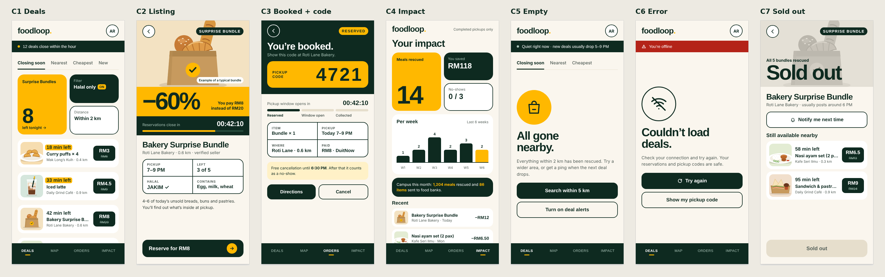

# foodloop
FoodLoop is a proposed software-based marketplace designed to connect food businesses with customers interested in unsold surplus food at discounted prices. 

Students and nearby customers reserve discounted surplus food from campus sellers (cafés, bakeries,
food stalls) and collect it themselves during a pickup window. Leftovers can be offered to a food bank.
Built for the ENT600 Technology Entrepreneurship New Product Development (NPD) assignment.

## Status

| Part | Status |
|---|---|
| System workflow and business rules | ✅ designed |
| UI mockups (style C: forest, marigold, cream) | ✅ approved |
| Laravel + MySQL prototype | ❌ not started |

All shop names, prices and numbers in the mockups are **demo data**, not real offers or research results.

## Repo layout

| Path | What's in it |
|---|---|
| `docs/PROJECT_NOTES.md` | What changed, why, and how it was tested |
| `docs/WORKING_AGREEMENTS.md` | Decisions, current status and next steps |
| `docs/mockups/` | PNG screenshots of every approved screen |
| `docs/demo-food/` | Drawn food pictures used as stand-ins for seller photos |

## Planned stack

Laravel (PHP) and MySQL, run locally with Laragon or Herd on Windows. Setup steps will be added when
the prototype is built.
